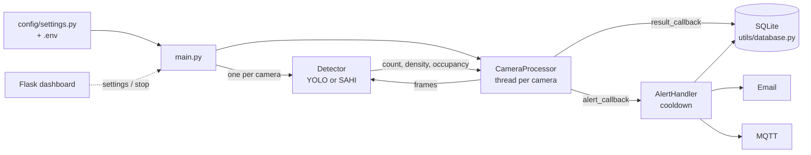

# Smart Campus Monitoring

A Python-based overcrowding detection system for campus camera feeds. It counts people in video using a YOLO model (optionally with SAHI slicing inference), tracks crowd density and occupancy, stores results in a local SQLite database, and sends alerts through email and MQTT. It works on live camera streams and on recorded video files.

> **Branch note:** this README documents the `dev` branch.

---

## Table of Contents

1. [Project Overview](#project-overview)
2. [Problem Statement](#problem-statement)
3. [Objectives](#objectives)
4. [Key Features](#key-features)
5. [Technology Stack](#technology-stack)
6. [System Architecture](#system-architecture)
7. [Project Structure](#project-structure)
8. [Prerequisites](#prerequisites)
9. [Installation and Setup](#installation-and-setup)
10. [Environment Configuration](#environment-configuration)
11. [How to Run](#how-to-run)
12. [Usage Guide](#usage-guide)
13. [Database](#database)
14. [Testing](#testing)
15. [Limitations and Future Enhancements](#limitations-and-future-enhancements)
16. [Items Requiring Confirmation](#items-requiring-confirmation)
17. [Contributors](#contributors)

---

## Project Overview

Smart Campus Monitoring analyses video from one or more cameras and raises an alert when the number of people in view (or their density) crosses a configured threshold. Each camera is processed in its own thread, and every detection result is written to a SQLite database. Alerts are rate-limited by a cooldown so the same event does not trigger repeated notifications.

There are two entry points:

| Entry point | Purpose |
|---|---|
| `main.py` | Monitor live cameras / streams defined in the configuration |
| `run_batch.py` | Process recorded video files offline and print a summary |

## Problem Statement

Crowded areas on a campus (entrances, corridors, canteens, event spaces) are hard to supervise manually. Staff need an automated way to know when a monitored area exceeds a safe or desired occupancy, so they can react quickly.

## Objectives

- Detect and count people in camera video using an object-detection model.
- Flag overcrowding using configurable count, density and capacity thresholds, optionally limited to a region of interest (ROI).
- Notify the right people through multiple channels, without flooding them with duplicate alerts.
- Keep a history of detections and alerts for later review.

## Key Features

Features below are confirmed from `main.py`, `run_batch.py`, `test.py` and `requirements.txt`.

- **Multi-camera live monitoring** with one processing thread per camera (`CameraProcessor`).
- **Two detector options**: standard YOLO (`OvercrowdingDetector`) or SAHI sliced inference (`SAHIOvercrowdingDetector`) enabled per camera via `use_sahi`.
- **Per-camera settings**: `count_threshold`, `density_threshold`, `roi`, `max_capacity`, `source`, `output_path`.
- **Alerting** through `AlertHandler` with a configurable cooldown (`ALERT_COOLDOWN_SECONDS`) and two notifier types:
  - Email (`DynamicEmailNotifier`) – sender, app password and recipients saved from the dashboard are read at send time; values in `.env` / `settings.py` act as fallback.
  - MQTT (`MQTTNotifier`) – enabled only when `enable_mqtt` is set.
- **SQLite persistence** of detections and alerts (`utils/database.py`).
- **Annotated video output** for each camera (`output_path`) and an optional live preview window (`--display`).
- **Batch processing** of a folder or list of video files with frame skipping (`--frame-stride`) and an end-of-run summary.
- **Web dashboard** (`dashboard/`, Flask) used to manage settings such as email credentials/recipients and to stop the monitoring process (the Stop button sends `SIGTERM`, which `main.py` handles gracefully).
- **Graceful shutdown** on Ctrl+C or `SIGTERM`.

## Technology Stack

| Area | Technology |
|---|---|
| Language | Python |
| Object detection | [Ultralytics](https://docs.ultralytics.com/) YOLO (`ultralytics>=8.2.0`) |
| Slicing inference | [SAHI](https://github.com/obss/sahi) (`sahi>=0.11.16`) |
| Video / image handling | OpenCV (`opencv-python>=4.9.0`), NumPy (`numpy>=1.26.0`) |
| Dashboard | Flask (`flask>=3.0.0`) |
| MQTT alerts | paho-mqtt (`paho-mqtt>=1.6.1`) |
| Email alerts | SMTP |
| Database | SQLite |

## System Architecture



**Flow summary**

1. `main.py` loads cameras from `DEFAULT_CAMERAS`, builds a detector for each, and warms it up.
2. `CameraProcessor` reads frames in a thread per camera and runs the detector.
3. Each result is stored in the database; results that breach thresholds go to `AlertHandler`.
4. `AlertHandler` suppresses repeats within the cooldown, logs the alert, and fans it out to all enabled notifiers.

`run_batch.py` follows a simpler path: `BatchProcessor` runs the detector over each video file and aggregates statistics (frames processed, peak count, alert count, peak occupancy).

## Project Structure

```
Smart-Campus-Monitoring/
├── alerts/          # AlertHandler and notifiers (email, MQTT)
├── config/          # settings.py – cameras, notification and path settings
├── dashboard/       # Flask web dashboard
├── detectors/       # BaseDetector, YOLO detector, SAHI detector
├── processors/      # CameraProcessor, VideoProcessor, BatchProcessor
├── utils/           # Database helper (SQLite)
├── main.py          # Live multi-camera monitoring entry point
├── run_batch.py     # Offline batch processing of recorded videos
├── test.py          # Local pipeline sanity tests (no YOLO weights needed)
├── requirements.txt # Python dependencies
└── .gitignore
```

> Contents of the individual files inside each folder were not all inspected; see [Items Requiring Confirmation](#items-requiring-confirmation).

## Prerequisites

- Python 3 (exact supported version not specified in the repository)
- `pip`
- A YOLO model weights file at the path defined as `MODEL_PATH` in `config/settings.py`
- A camera, RTSP/HTTP stream, or video file for each configured source
- Optional: an SMTP account (e.g. an app password) and/or an MQTT broker, depending on which alert channels you enable

## Installation and Setup

```bash
# 1. Clone the repository (dev branch)
git clone -b dev https://github.com/Yshnavii/Smart-Campus-Monitoring.git
cd Smart-Campus-Monitoring

# 2. (Recommended) create a virtual environment
python -m venv venv
source venv/bin/activate        # Windows: venv\Scripts\activate

# 3. Install dependencies
pip install -r requirements.txt
```

`requirements.txt` installs the core packages (`ultralytics`, `opencv-python`, `numpy`, `flask`), SAHI, and the optional MQTT library (`paho-mqtt`).

## Environment Configuration

Configuration is read from `config/settings.py`, which `main.py` uses for `DEFAULT_CAMERAS`, `NOTIFICATION`, `DB_PATH`, `MODEL_PATH` and `ALERT_COOLDOWN_SECONDS`. Values may also come from a `.env` file.

Variables confirmed in the repository:

| Variable | Purpose |
|---|---|
| `ENABLE_MQTT` | Set to `true` to enable MQTT alerts |

The `NOTIFICATION` settings also include SMTP host/port/user/password, the alert email list, and the MQTT broker and port. The exact environment variable names for these were not verified.

**Never commit real passwords, tokens or app passwords.** Keep them in a local `.env` file (confirm it is listed in `.gitignore`) or enter email credentials through the dashboard.

## How to Run

### Live monitoring

```bash
# Run headless
python main.py

# Show annotated video windows
python main.py --display
```

### Batch processing of recorded videos

```bash
# Process every video in a folder
python run_batch.py --folder recordings/

# Process specific files and choose the output directory
python run_batch.py --files a.mp4 b.mp4 c.mp4 --output-dir annotated/

# Use SAHI and a custom threshold
python run_batch.py --folder recordings/ --sahi --count-threshold 20
```

**`run_batch.py` options**

| Option | Description | Default |
|---|---|---|
| `--folder` | Folder of videos (mutually exclusive with `--files`, one is required) | – |
| `--files` | One or more specific video files | – |
| `--output-dir` | Where annotated videos are written | `batch_output` |
| `--count-threshold` | People count that triggers an alert | `15` |
| `--density-threshold` | Density threshold | none |
| `--max-capacity` | Maximum capacity used for occupancy % | none |
| `--frame-stride` | Process every Nth frame | `5` |
| `--sahi` | Use SAHI slicing inference | off |

### Dashboard

The repository contains a Flask dashboard in `dashboard/`. The launch command for it could not be verified (see below).

## Usage Guide

1. Define your cameras (name, source, thresholds, optional ROI, `max_capacity`, `use_sahi`, `output_path`) in `config/settings.py`.
2. Configure the alert channels you want (email, MQTT).
3. Start `python main.py`. Each registered camera is printed on start-up as `Registered: <name> (<source>)`.
4. Stop with Ctrl+C, or with the dashboard's Stop button.
5. For recorded footage, use `run_batch.py` and read the printed batch summary.

## Database

- SQLite, with the file location set by `DB_PATH` in `config/settings.py`.
- The database is created and written by `utils/database.py` when `main.py` starts; no manual setup step is present in the code reviewed.
- Stored data, based on `test.py`: per-frame detection records (count, average count, density, occupancy %, alert flag) and alert records, with helper methods `recent_detections()` and `recent_alerts()`.

## Testing

`test.py` is a self-contained sanity test that uses a `FakeDetector` and `FakeNotifier`, so it needs **no YOLO weights and no network access**.

```bash
python test.py
```

It checks:

1. `BatchProcessor` / `VideoProcessor` process every frame once and finish at end-of-file, with correct peak count, alert count, annotated output and peak occupancy.
2. `CameraProcessor` thread start/stop lifecycle.
3. `AlertHandler` cooldown suppression and notifier fan-out, plus DB logging of non-suppressed alerts.
4. A `Database` insert/read round trip.

The script prints `PASS`/`FAIL` per check and exits non-zero on any failure. It writes temporary files to `/tmp/pipeline_test`, so on Windows that path may need changing. Test results were not executed as part of writing this README.

## Limitations and Future Enhancements

**Verified limitations**

- `test.py` uses a hard-coded `/tmp` path, which is Unix-oriented.
- The graceful-stop signal (`SIGTERM`) behaviour is described in the code for Linux/macOS/Raspberry Pi.
- Automated tests only cover the pipeline logic with a fake detector; real model accuracy is not tested.

**Possible improvements (suggestions, not implemented)**

- Add a `LICENSE` and a `.env.example` file.
- Pin dependency versions and state the supported Python version.
- Add unit tests for the real detectors and notifiers.
- Document the dashboard routes.

## Items Requiring Confirmation

The following could not be verified from the files inspected (`main.py`, `run_batch.py`, `test.py`, `requirements.txt`, and the repository file listing). Please check them before publishing:

- Exact contents of `config/settings.py` (camera definitions, `MODEL_PATH` default, full list of environment variable names, `.env` loading).
- The dashboard's entry file, run command, port, pages and any API endpoints.
- Contents of `detectors/`, `processors/`, `alerts/` and `utils/` beyond what `main.py` and `test.py` import and call.
- Which YOLO weights are expected and where they should be placed.
- Supported Python version.
- Whether screenshots or demo media exist.
- Whether `.gitignore` excludes `.env`, model weights and the database file.

## Contributors

Repository owner: [Vshnavi K B](https://github.com/Yshnavii), [Muhammed Asharaf N](https://github.com/Muhammedasharafn), [Amna Yasmine](https://github.com/amnayasmine).
